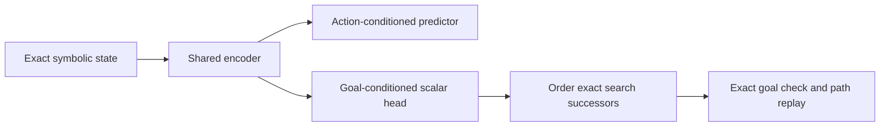

# JEPA4M: Predictive Representations and Verified Search

**Can learning successor representations improve symbolic planning?** This research project combines PyTorch state encoders, action-conditioned latent prediction, SIGReg regularization, exact symbolic environments and verified search. Its contribution includes controlled positive and negative evidence, with quality and computation considered separately.

This compact portfolio edition contains the original Cube environment, equality-preserving expression rewriting, model components, bounded exact-state search and self-contained tests. A new CPU demonstration makes the core implementation runnable without datasets, checkpoints, accounts or a GPU. It is a small engineering example, not a reproduction of the original studies.

## Run the CPU example

Python 3.11 or newer:

```bash
python3 -m venv .venv
source .venv/bin/activate
python -m pip install -e '.[test]'
python -m pytest -q
python examples/cpu_demo.py
```

The example generates short 2x2 Cube transitions locally, trains a small shared encoder and action predictor for 80 updates, records finite latent losses, then runs a separate exact breadth-first search and replays its returned solution. The search demonstration does not use the trained model. It writes `artifacts/local_demo.json`; it saves no checkpoint and makes no network calls. Dependencies may download during installation.

Distinct episode seeds do not imply disjoint symbolic states. Both endpoints share the encoder and receive gradients; there is no EMA or detached target branch. The target representation changes while learning, so successor-latent MSE is not a fixed-target prediction benchmark and does not establish planning improvement. No learned-solver success rate is claimed by this example.

The run on 26 October 2026 used Python 3.12.7, NumPy 1.26.4 and PyTorch 2.7.1. All **37 original tests passed**. The CPU example completed 80 updates on 384 generated transitions and verified an optimal three-move BFS solution by replay. Its composite training loss changed from 2.0922 to 0.5681, while held-out successor-latent MSE rose from 0.03366 to 0.38035. Those are different objectives with a changing encoder target; this smoke demonstration is not evidence of improved held-out prediction. See the complete [saved demonstration report](artifacts/synthetic_demo.json).

## Engineering components



- **Exact environments:** Cube moves derive from integer 3D geometry, with physical-state validation and trace replay. Rewriting operates on ordered ASTs and preserves elementary algebraic identities.
- **Predictive models:** one-hot Cube encoders, residual blocks, action embeddings, residual successor-latent predictors and goal-conditioned scalar heads. The demo trains the encoder/predictor; it does not train the scalar head.
- **Regularization and controls:** a documented SIGReg adaptation, gradients through both state endpoints, and historical comparisons against direct training, wrong-action controls and simpler alignment objectives.
- **Budget-aware search:** exact-state beam search and bidirectional BFS report expansions, stop reasons, replay verification, time overruns and coarse bookkeeping-memory estimates. Learned scores rank exact successors; they do not replace the symbolic transition system.
- **Tests:** original checks cover move identities, independent orientation oracles, unreachable states, reversible rewriting, semantics preservation, search budgets, optimal-distance checks on shallow cases, transition replay and gradients.

Search time budgets are cooperative: a model call can overrun its deadline and the result reports that overrun. Memory figures are estimates, not measured RSS or enforced memory quotas. A budget failure does not prove unreachability; beam-search success does not prove optimality.

## Historical findings and their limits

These are saved research findings through 10 October 2026, retained from the reviewed publication edition. They were **not rerun for this portfolio export**. Each row has its own population and metric; they are not a single leaderboard.

| Study | Saved finding | Interpretation |
|---|---|---|
| [Cube2 allocation comparison](reports/bellman_allocation/RESULTS.md) | Verified coverage +3.379 percentage points; 95% CI [1.719, 5.039] | A benefit within one sparse-label, cost-checked recipe. |
| [Cube3 compact alignment](reports/cube3_production_cost_recovery/RESULTS.md) | Exact-8/10 optimal coverage +5.4565 pp; 95% CI [3.7476, 7.2266] | Strongest practical recipe uses neighbor alignment + SIGReg **without a predictor**. |
| [Cube3 action control](reports/cube3_mlp_mechanism/RESULTS.md) | Correct-minus-wrong-action +1.0132 pp; 95% CI [-0.4883, 2.4780] | Correct-action specificity remains unestablished. |
| [Cube3 SIGReg control](reports/cube3_sigreg_factorial/RESULTS.md) | Alignment-only minus full recipe -4.5654 pp; 95% CI [-6.2015, -3.0151] | Supports retaining SIGReg in that recipe, not universal necessity. |
| [Native Cube4 utility](reports/cube4_hard_utility/RESULTS.md) | Verified coverage +0.0651 pp; 97.5% CI [-1.9371, 2.1161] | No established practical gain. |
| [Native Cube4 joint training](reports/cube4_joint_utility/RESULTS.md) | Witness-qualified coverage -8.724 pp; 97.5% CI [-14.844, -3.125] | The tested joint JEPA recipe was worse than direct scalar training. |

The evidence does not establish a general advantage for an action-conditioned JEPA predictor, multimodal perception, a physical world model, or a competitive general Cube solver. Positive latent geometry or prediction metrics are not treated as search-utility gains. Historical reports describe conditional comparisons rather than external scientific replications.

## What is included

| Path | Purpose |
|---|---|
| `src/jepa4math/cube.py`, `rewriting.py` | Exact environments and replay/semantic checks |
| `src/jepa4math/models.py`, `data.py`, `rewrite_data.py` | Original PyTorch models, SIGReg and generated transitions |
| `src/jepa4math/search.py` | Bounded search and explicit accounting |
| `tests/` | Four original self-contained test files |
| `scripts/rewrite_benchmark.py` | Original bounded rewriting pilot, required by its tests |
| `examples/cpu_demo.py` | Newly added small portable CPU demonstration |
| `reports/` | Six selected historical result reports |
| `docs/`, [THIRD_PARTY_NOTICES.md](THIRD_PARTY_NOTICES.md) | Method adaptation and upstream attribution |
| [source_manifest.json](source_manifest.json) | Source-relative paths, original/exported hashes and transformations |

The full research archive, experiment runners, Cube4 implementation, large datasets, exact-distance tables, checkpoints, protected panels and raw traces are outside this compact release. Consequently it cannot reproduce the six historical tables from a fresh clone. Historical report links to omitted artifacts are rendered as plain labels; host-specific absolute paths are removed. Original core Python and test files retain their bytes. The manifest records this lineage, not independent authorship or ownership verification.

## Rights and references

See [THIRD_PARTY_NOTICES.md](THIRD_PARTY_NOTICES.md) for the pinned upstream references and notices. SIGReg follows the LeJEPA method and documented local adaptation; LeJEPA is recorded under **CC BY-NC 4.0**, not MIT. CayleyPy Cube, LeWorldModel and selected Halide material are historical references; their source trees, binaries and weights are not bundled. The independent Cube geometry implementation is included here.

The original workspace supplied no repository-wide license. This portfolio edition reserves rights pending an owner decision; public visibility is not an open-source license. Third-party terms remain applicable to their respective material. The source lineage does not imply publication, endorsement or peer review by the referenced authors.
